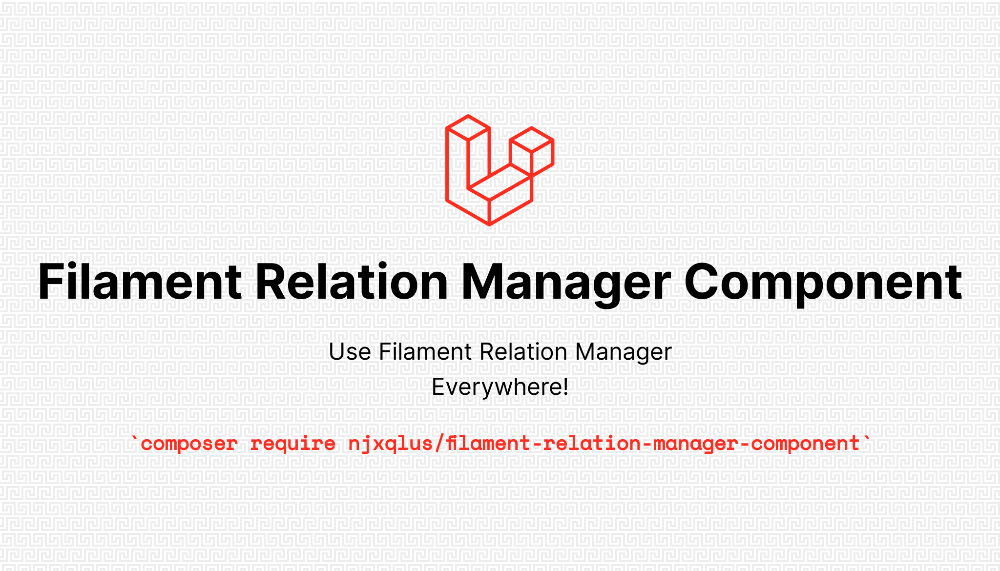

# Use Filament Relation Manager Everywhere!

[](https://packagist.org/packages/njxqlus/filament-relation-manager-component)
[](https://github.com/njxqlus/filament-relation-manager-component/actions?query=workflow%3Arun-tests+branch%3Amain)
[](https://github.com/njxqlus/filament-relation-manager-component/actions?query=workflow%3A"Fix+PHP+code+style+issues"+branch%3Amain)
[](https://packagist.org/packages/njxqlus/filament-relation-manager-component)




Use Filament Relation Manager Everywhere!

## Installation

You can install the package via composer:

```bash
composer require njxqlus/filament-relation-manager-component
```

Optionally, you can publish the views using

```bash
php artisan vendor:publish --tag="filament-relation-manager-component-views"
```

## Usage

Use `->lazyLoaded()` to defer mounting the relation manager. Pass `false` to mount it immediately (the default), or a closure to decide at runtime. This API works with Filament 4 and 5.

Replace `->lazy($condition)` with `->lazyLoaded($condition)` and `->isLazy()` with `->isLazyLoaded()`. The old methods still work for backward compatibility.

The examples below mount the relation managers immediately.

```php
public static function form(Schema $schema): Schema
{
    return $schema
        ->schema([
            Schemas\Components\Tabs::make()->tabs([
                Schemas\Components\Tabs\Tab::make('Versions')->schema([
                    \Njxqlus\Filament\Components\Forms\RelationManager::make()->manager(RelationManagers\VersionsRelationManager::class)->lazyLoaded(false)
                ]),
                Schemas\Components\Tabs\Tab::make('Stands')->schema([
                    \Njxqlus\Filament\Components\Forms\RelationManager::make()->manager(RelationManagers\StandsRelationManager::class)->lazyLoaded(false)
                ]),
                Schemas\Components\Tabs\Tab::make('Contexts')->schema([
                    \Njxqlus\Filament\Components\Forms\RelationManager::make()->manager(RelationManagers\ContextsRelationManager::class)->lazyLoaded(false)
                ]),
            ])
        ]);
}

public static function infolist(Schema $schema): Schema
{
    return $schema->schema([
        Schemas\Components\Tabs::make()->tabs([
            Schemas\Components\Tabs\Tab::make('Versions')->schema([
                \Njxqlus\Filament\Components\Infolists\RelationManager::make()->manager(RelationManagers\VersionsRelationManager::class)->lazyLoaded(false)
            ]),
            Schemas\Components\Tabs\Tab::make('Stands')->schema([
                \Njxqlus\Filament\Components\Infolists\RelationManager::make()->manager(RelationManagers\StandsRelationManager::class)->lazyLoaded(false)
            ]),
            Schemas\Infolists\Components\Tabs\Tab::make('Contexts')->schema([
                \Njxqlus\Filament\Components\Infolists\RelationManager::make()->manager(RelationManagers\ContextsRelationManager::class)->lazyLoaded(false)
            ]),
        ])
    ]);
}
```

## Changelog

Please see [CHANGELOG](CHANGELOG.md) for more information on what has changed recently.

## Contributing

Please see [CONTRIBUTING](.github/CONTRIBUTING.md) for details.

## Security Vulnerabilities

Please review [our security policy](../../security/policy) on how to report security vulnerabilities.

## Credits

- [Mikael Ahabalyants](https://github.com/njxqlus)
- [All Contributors](../../contributors)

## License

The MIT License (MIT). Please see [License File](LICENSE.md) for more information.
